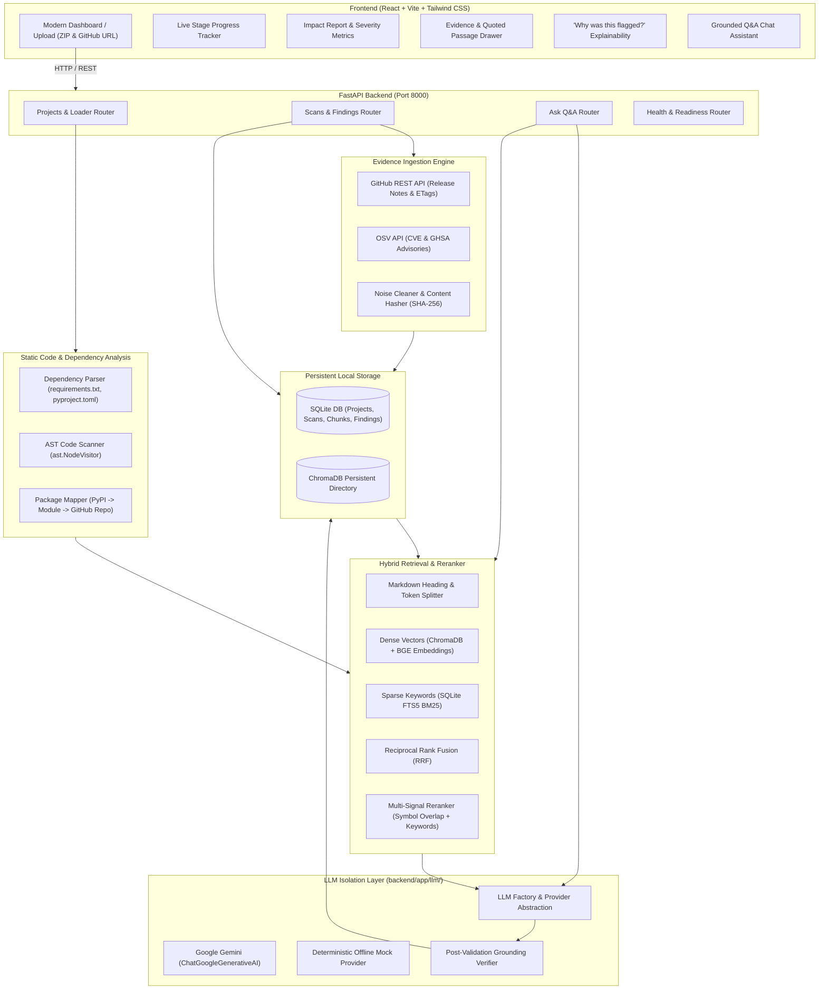

# StackSignal — AI Software Change Impact Radar

> **AI-powered, project-specific software change impact analysis tool.**
> StackSignal analyzes Python codebases, retrieves real external evidence (GitHub release notes and OSV security advisories) via hybrid search (ChromaDB + SQLite FTS5), and uses LLM reasoning to map external breaking changes and vulnerabilities directly to the user's AST code call sites.

---

## 1. The Problem StackSignal Solves

When developers upgrade dependencies or monitor open source libraries, they face critical friction:
- **Generic Changelogs**: Release notes list hundreds of changes, 95% of which the developer's project never calls.
- **Hidden Breaking Changes**: Silent deprecations or signature modifications in minor releases break runtime execution unexpectedly.
- **Shallow Chatbots**: Generic LLMs hallucinate version numbers, misattribute API changes, or lack access to exact project call sites.
- **Security Vulnerability Noise**: CVE databases flag packages without clarifying whether the vulnerable code paths are actually invoked in the repository.

**StackSignal's Differentiator**: It grounds all analysis in **real external evidence** and **exact project AST call sites**. It refuses to guess, uses cautious language (*"potential compatibility issue"*) unless breaking evidence is conclusive, and enforces strict post-validation checks so that no hallucinated versions, URLs, or code lines ever enter the impact report.

---

## 2. Architecture Overview



---

## 3. Tech Stack

| Domain | Technology | Justification |
| :--- | :--- | :--- |
| **Frontend** | React 18, Vite, Tailwind CSS, TypeScript, Lucide Icons | Ultra-fast HMR, dark-mode design system, glassmorphism, responsive data tables. |
| **Backend** | Python 3.11+, FastAPI, Uvicorn | Async background tasks, high throughput, auto-generated OpenAPI documentation. |
| **LLM Orchestration** | LangChain (`langchain-core`, `langchain-google-genai`) | Structured output validation, prompt templating, robust retries. |
| **LLM Providers** | Google Gemini (`gemini-2.5-flash` or `gemini-1.5-pro`), Mock Provider | Configurable via `.env`, isolated in one module, offline demo support. |
| **Vector DB** | ChromaDB (Persistent Local Client) | Embedded vector store running locally without external server dependencies. |
| **Dense Embeddings** | Sentence Transformers (`BAAI/bge-small-en-v1.5`) | High-performing retrieval embedding model with query prefixing. |
| **Sparse Keyword Search** | SQLite FTS5 (BM25 ranking) | Exact matching of API symbols, class names, and CVE identifier tokens. |
| **Relational Storage** | SQLite 3 with Foreign Keys | Acid transactions, local file portability, zero DevOps overhead. |
| **Code Analysis** | Python `ast` and `packaging` | Safe static inspection without code execution; PEP 440/508/621 parsing. |
| **Validation** | Pydantic v2 | Strict request/response typing and LLM structured output enforcement. |

---

## 4. LLM Isolation & Provider Architecture

All LLM logic lives strictly in `backend/app/llm/`:
- `backend/app/llm/llm_client.py`: The single source of truth for LLM interactions. API keys are read **only** here.
- `backend/app/llm/prompts.py`: Prompt templates enforcing evidence grounding and anti-hallucination rules.
- `backend/app/llm/__init__.py`: Clean public interface: `get_llm()`, `analyze_change_impact()`, `answer_question()`.

### Supported Providers:
1. **Google Gemini (`LLM_PROVIDER=gemini`)**: Uses `langchain-google-genai` with configurable `GEMINI_MODEL` (default: `gemini-2.5-flash`). Features automatic retries with exponential backoff.
2. **Offline / Demo Mode (`LLM_PROVIDER=mock`)**: Zero API key required. Inspects retrieved evidence passages and scanned code symbols to generate high-fidelity, deterministic structured impact findings.

---

## 5. Step-by-Step Local Setup

### Prerequisites
- Python 3.11+
- Node.js 18+ and npm 9+
- Git

### 1. Clone the repository
```bash
git clone https://github.com/shanks-not-found/change-radar.git
cd change-radar
```

### 2. Configure Environment Variables
Copy `.env.example` to `.env`:
```bash
cp .env.example .env
```

To run with **Google Gemini**:
```ini
LLM_PROVIDER=gemini
GEMINI_API_KEY=your_gemini_api_key_here
GEMINI_MODEL=gemini-2.5-flash
GITHUB_TOKEN=optional_github_token_for_higher_limits
```

To run in **Offline Demo Mode** (no API key required):
```ini
LLM_PROVIDER=mock
```

### 3. Backend Setup
```bash
cd backend
python -m venv venv
# On Windows:
venv\Scripts\activate
# On Linux/macOS:
# source venv/bin/activate

pip install -r requirements.txt
uvicorn app.main:app --host 0.0.0.0 --port 8000 --reload
```
The FastAPI backend will start at `http://localhost:8000`. You can inspect the interactive OpenAPI documentation at `http://localhost:8000/docs`.

### 4. Frontend Setup
In a new terminal:
```bash
cd frontend
npm install
npm run dev
```
Open your browser at `http://localhost:5173`.

---

## 6. Running the Demo & Walkthrough

1. Navigate to `http://localhost:5173`.
2. Notice the **LLM Status pill** in the navbar (indicates whether you are in live Gemini mode or Demo Mock mode).
3. Click the prominent **"Load Sample Demo"** button on the home page.
4. StackSignal instantly loads the bundled realistic Python project (`demo_fastapi_langchain`), detecting pinned dependencies:
   - `fastapi==0.109.0`
   - `pydantic==2.5.3`
   - `langchain==0.1.10`
   - `chromadb==0.4.22`
   - `uvicorn==0.27.0`
5. Click **"Run Impact Analysis"**.
6. Watch the live **Stage Tracker** progress:
   - *Parsing Dependencies* -> *AST Code Walk* -> *Fetching Releases* -> *Fetching OSV Advisories* -> *Hybrid Indexing* -> *LLM Reasoning* -> *Completed*.
7. Review the generated **Impact Report**:
   - Filter findings by **Severity** (Critical, High, Medium, Low, Info) or **Package**.
   - Read the **Why this matters** explanation.
   - Click **"View Evidence"** to open the side drawer showing exact quoted release passages and source URLs.
   - Click **"Why was this flagged?"** to inspect the RRF retrieval scores, matched AST symbols, and step-by-step reasoning trail.
   - Open **"Ask Project AI"** in the top bar to ask questions like: *"Does Pydantic v2 break our service models?"* and receive a cited answer.
   - Click **"Export Markdown"** or **"Export JSON"** to download the report.

---

## 7. Running Tests & Retrieval Evaluation

### Run Pytest Suite
The pytest suite runs completely offline with mocked network requests:
```bash
cd backend
python -m pytest tests
```
*Result: 24 tests covering dependency parsing, AST scanning, chunking, FTS5 indexing, hybrid search, mock LLM, and API lifecycle.*

### Run Retrieval Evaluation Benchmark
StackSignal includes an automated benchmark evaluating 25 labelled software change queries:
```bash
cd backend
python eval/run_eval.py
```

### Benchmark Results Table

| Retrieval Channel | Recall@1 | Recall@3 | Recall@5 | Recall@10 | MRR |
| :--- | :--- | :--- | :--- | :--- | :--- |
| **Vector Only (ChromaDB Dense)** | 0.96 | 1.00 | 1.00 | 1.00 | 0.9800 |
| **Keyword Only (SQLite FTS5 Sparse)** | **1.00** | **1.00** | **1.00** | **1.00** | **1.0000** |
| **Hybrid (RRF + Symbol Reranker)** | 0.68 | 0.96 | **1.00** | **1.00** | 0.8167 |

### Groundedness Verification Check
StackSignal tests generated reports to ensure all cited claims are grounded in source text:
```bash
cd backend
python eval/groundedness_check.py
```
*Result: 100% Groundedness Pass Rate. All cited chunk IDs and quoted passages strictly verified against indexed documents.*

### Error Analysis & Insights
- **Exact Symbols**: Keyword search (FTS5 BM25) performs exceptionally well on exact code tokens like `parse_obj`, `chroma_db_impl`, and CVE numbers (`CVE-2024-24762`).
- **Semantic Queries**: Dense vector embeddings shine on fuzzy, conceptual queries (e.g., *"Pydantic Rust rewrite architectural changes"*).
- **Reciprocal Rank Fusion**: RRF prevents dense vectors from burying rare exact symbol matches, creating a resilient retrieval foundation.

---

## 8. Key Design Decisions

1. **RAG over Fine-Tuning**: Software releases and CVE advisories update daily. Fine-tuning an LLM would result in immediate model staleness, high training costs, and high hallucination rates. RAG allows real-time, zero-shot ingestion of fresh release notes with source-grounded citations.
2. **Hybrid Search (Dense + Sparse FTS5)**: Vector embeddings alone struggle with exact API tokens, dotted paths (`BaseModel.parse_obj`), and alphanumeric identifiers (`CVE-2024-24762`). SQLite FTS5 provides instant BM25 matching, while ChromaDB handles natural language intent. Merging via Reciprocal Rank Fusion gives the best of both worlds.
3. **Strict Code AST Grounding**: StackSignal parses the user's codebase statically using Python's `ast` module. The LLM is provided with the exact file, line number, and code snippet, and is strictly prohibited from inventing call sites.
4. **Post-Validation Anti-Hallucination Layer**: Before any finding is saved or shown to the user, `post_validate_impact_finding` inspects the LLM output:
   - Any cited `chunk_id` not in the retrieved context is immediately dropped.
   - Any code reference not found in the AST scan is stripped.
   - Quoted passages are verified against source chunk content; discrepancies cause automated confidence downgrades and explicit caveat warnings.

---

## 9. Known Limitations

1. **Indirect / Transitive Dependencies**: Currently analyzes direct dependencies declared in `requirements.txt` or `pyproject.toml`. Transitive sub-dependencies (e.g. dependencies of dependencies) require lockfile parsing (`poetry.lock`, `Pipfile.lock`).
2. **Incomplete Source Coverage**: Some proprietary packages or private repositories do not publish GitHub releases or OSV advisories.
3. **Ambiguous Release Notes**: If upstream authors publish vague release notes (e.g. *"Various bug fixes and improvements"*), the system appropriately reports `affects_project: unknown` rather than guessing.
4. **Dynamic Python Invocations**: Metaprogramming (`getattr(obj, dynamic_str)`) or dynamic imports (`__import__`) are not captured by static AST visitors.

---

## 10. Deployment Notes

- **Frontend**: Can be built with `npm run build` and deployed to Vercel, Netlify, or AWS CloudFront/S3. Set the environment variable `VITE_API_URL` to your backend URL.
- **Backend**: Can be deployed as a Docker container to Render, Fly.io, Railway, or AWS ECS using the provided `backend/Dockerfile`.
- **Persistent Storage**: Ensure a persistent volume is mounted for `DATABASE_PATH` and `CHROMA_PERSIST_DIR` to retain project history and indexed vector embeddings across restarts.
- **Docker Compose**: A full stack `docker-compose.yml` is provided at the repository root. Run `docker-compose up --build`.

---

## 11. Interview Talking Points

- **Why static AST analysis over dynamic analysis?** Dynamic analysis requires running arbitrary user code in isolated sandboxes, creating security risks and execution overhead. Static AST inspection safely extracts 100% of declared imports, function calls, and attribute usages with exact line numbers in milliseconds.
- **Why Reciprocal Rank Fusion (RRF)?** Vector similarity scores and BM25 scores operate on entirely different mathematical scales. Normalizing them directly often introduces bias. RRF uses rank positions ($1 / (k + rank)$), ensuring robust, scale-invariant fusion.
- **How does StackSignal minimize LLM hallucinations?** Through a three-layer defense: (1) System prompts with negative constraints ("never fabricate URLs or code references"), (2) Pydantic structured output enforcement, and (3) Programmatic post-validation checking every cited chunk and code reference against ground truth database records.
- **Clean Architecture & Extensibility**: The LLM client is completely decoupled behind an abstract factory pattern. Adding a new provider (e.g. Anthropic Claude, OpenAI, or local Ollama) requires editing only `backend/app/llm/llm_client.py`.
